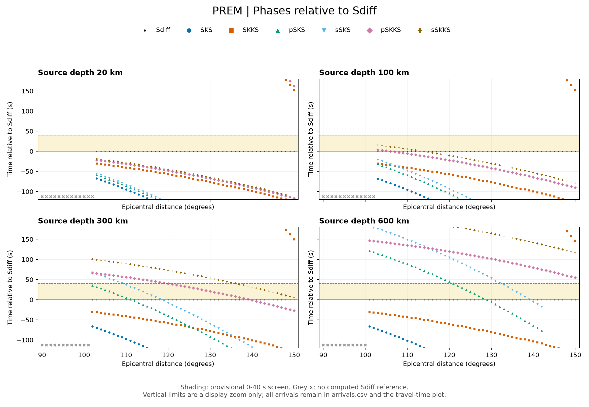

# Sdiff Travel-Time Analysis

An exploratory scientific computing project using Python, ObsPy and the PREM Earth model to compare seismic phase arrivals relative to Sdiff across source depths and epicentral distances.

The question is simple: **which other seismic phases are predicted to arrive near Sdiff, and how does that depend on earthquake depth and distance?** The workflow calculates arrival times, plots them, flags arrivals in a provisional time window and checks the exported results. It runs locally without waveform downloads or server access.



## Setup and reproduction

Tested with Python 3.12.14. From this project directory, on macOS or Linux:

```bash
python3 -m venv .venv
source .venv/bin/activate
python -m pip install -r requirements.txt
python run.py
python verify.py
```

Use Python 3.12 for the tested setup. The scripts generate results in `output/`; rerunning them overwrites the corresponding files. The included figures and tables can also be viewed without running the code.

## Method and exploratory choices

| Setting | Value |
| --- | --- |
| Earth model | ObsPy's built-in `prem` |
| Source depths | 20, 100, 300 and 600 km |
| Epicentral distances | 90 to 150 degrees, at 1-degree intervals |
| Receiver depth | 0 km, at the surface |
| Phases | Sdiff, SKS, SKKS, pSKS, sSKS, pSKKS, sSKKS |
| Relative time | Phase arrival time minus Sdiff arrival time at the same depth and distance |
| Provisional screen | Relative time from 0 to 40 seconds, inclusive |

These are exploratory parameter choices, not validated selection criteria. The screen has no pre-Sdiff interval. Negative relative times mean earlier arrivals; positive values mean later arrivals. Sdiff itself is the reference, so its relative time is zero.

Initial lowercase `p` and `s` describe upgoing P- and S-wave legs from the source, followed by surface interactions. They are not SH/SV component labels. See the [ObsPy phase-naming documentation](https://docs.obspy.org/packages/obspy.taup.html#phase-naming-in-obspy-taup).

Every returned arrival is retained, including multiple arrivals and major-arc paths. Points are plotted without connecting lines to avoid joining different paths or bridging missing results. The relative-time figure is zoomed to -120 to +180 seconds; arrivals outside this display range remain in the full table and absolute-time figure.

## Example result

For a source at **300 km depth** and **110 degrees epicentral distance**:

| Phase | Time after origin, seconds | Time relative to Sdiff, seconds |
| --- | ---: | ---: |
| Sdiff | 1542.02 | 0.00 |
| pSKS | 1547.23 | +5.21 |
| sSKS | 1578.72 | +36.70 |

Both depth phases fall inside the provisional 0 to 40 second window. This flags temporal proximity for further investigation; it does not establish observable waveform interference.

The full grid gives the following sampled hits, excluding Sdiff itself:

| Source depth, km | Other phases within the provisional window: distance samples in degrees |
| --- | --- |
| 20 | None among the phases tested where Sdiff was returned |
| 100 | pSKKS: 103-106; sSKKS: 103-113 |
| 300 | pSKS: 102-111; sSKS: 110-118; pSKKS: 121-139; sSKKS: 137-150 |
| 600 | pSKS: 122-128; sSKS: 133-139 |

These ranges describe the 1-degree sample grid, not exact continuous boundaries. Arrivals just outside the window may still matter: pSKKS is at +40.116 seconds at 300 km / 120 degrees, and pSKS is at +40.390 seconds at 600 km / 121 degrees.

The combinations 20 km / 110-130 degrees and 600 km / 105-115 degrees have no other listed arrival in the provisional window. They are candidates for further checks, not certified clean observations. Results depend on both depth and distance; deeper events are not uniformly free of nearby phases.

## Files

| File | Purpose |
| --- | --- |
| `run.py` | Calculate arrivals and generate tables, settings and figures |
| `verify.py` | Check saved results against arithmetic rules and separate ray-path calls |
| `requirements.txt` | Package versions used for this exercise |
| [output/relative_times.png](output/relative_times.png) | Arrivals relative to Sdiff; shading marks the provisional window |
| [output/travel_times.png](output/travel_times.png) | Absolute travel times, including all returned arrivals |
| [output/arrivals.csv](output/arrivals.csv) | Full arrival table with units in column names |
| [output/screening_summary.csv](output/screening_summary.csv) | One row per depth and phase, summarising sampled window hits |
| [output/metadata.json](output/metadata.json) | Model, grid, software versions and table conventions |
| [output/verification.txt](output/verification.txt) | Numerical check report |

In the arrival table, blank numeric cells are missing values, never zero:

- `ok`: both the phase arrival and an Sdiff reference are available.
- `no_phase_arrival`: the model returned no arrival for that phase and query.
- `no_sdiff_reference`: a phase arrival exists but no Sdiff reference is available.

Grey crosses in the relative-time figure mark queries without an Sdiff reference; their displayed height is not an arrival time. `arrival_index` numbers arrivals within one phase/query, not persistent branches across distances. `purist_distance_deg` records the propagation-path angular distance, which can differ from the input epicentral distance. At 300 km / 110 degrees, for example, SKKS has both 110-degree and 250-degree paths; the latter is a major-arc solution.

In the summary table, an empty hit range means no sampled hit, not necessarily no arrivals. The `closest_to_40_*` columns identify the valid sample nearest +40 seconds, even if it is outside the window. The Sdiff row is the reference, not an interfering phase.

## Verification and limitations

The included check report covers 1,708 depth/distance/phase combinations and 2,440 exported rows. It checks relative-time subtraction, inclusive window flags and missing values, then compares 66 arrivals with separate single-phase `get_ray_paths` calls. The maximum arrival-time difference is approximately 0.00002057 seconds, below the 0.01-second tolerance. Both SKKS paths in the example above are checked.

These are internal consistency checks using the same ObsPy/PREM model, not independent validation of physical accuracy. The verification script targets the supplied grid and representative cases; revisit those checks if changing the experiment.

- TauP predicts ray-theoretical arrival times in a one-dimensional spherical background model. This project does not calculate amplitudes, waveform shapes, source radiation, ULVZ scattering or anisotropic splitting.
- Timing proximity alone cannot establish interference on an observed component. Waveform duration, component, signal-to-noise ratio and source properties need separate checks.
- Only the listed phases were screened. Sdiff depth phases, other multiples and coda were not comprehensively examined. Missing computed arrivals do not prove an absence of observed energy.
- Candidate events require recalculation at their actual source depths and station distances, followed by waveform inspection. This exercise does not identify universally safe depth or distance ranges, or distinguish anisotropic from layered structures.

## References and development

- [ObsPy TauP documentation](https://docs.obspy.org/packages/obspy.taup.html)
- [TauPyModel.get_travel_times API](https://docs.obspy.org/packages/autogen/obspy.taup.tau.TauPyModel.get_travel_times.html)
- [TauP phase naming](https://taup.readthedocs.io/en/latest/phaseNaming.html)

The initial code and documentation were developed with GPT assistance. This is a learning and exploratory analysis project using established tools and a reference Earth model.
